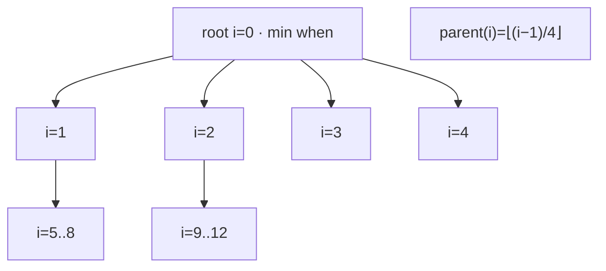

# HeapTimer

[](https://github.com/esrrhs/heap_timer)
[](https://github.com/esrrhs/heap_timer)
[](https://github.com/esrrhs/heap_timer/actions)
[](https://github.com/esrrhs/heap_timer/releases)

> **Header-only C++ 4-ary heap timer with monotonic deadlines and O(log n) add/delete/update.**

[English](README.md) | [Chinese](README_CN.md)

---

## Overview

**HeapTimer** is a small, dependency-free timer wheel alternative based on a **4-ary min-heap**, inspired by the [Golang 4-ary heap timer](https://github.com/golang/go/blob/release-branch.go1.3/src/pkg/runtime/time.goc).

Drop in a single header (`heap_timer.h`). No libraries to link.

## Features

* **Header-only**: one file, C++11, no third-party deps
* **4-ary heap**: fewer tree levels than a binary heap for large timer sets
* **Monotonic clock**: deadlines use `std::chrono::steady_clock`
* **O(log n) ops**: `Add` / `AddAt` / `Del` / `Update`
* **Move-only**: not copyable (nodes are not shared across instances) and **not thread-safe**


## 算法演示 / Algorithm Demo

Interactive visualization of the **4-ary min-heap** timer — open and click around:

**[▶ Online algorithm demo](https://esrrhs.github.io/heap_timer/)**

(Same file also works locally: [`docs/heap_timer_demo.html`](docs/heap_timer_demo.html) — single file, no build, no CDN.)

The demo mirrors the operations in `heap_timer.h`:

- **Insert Add / AddAt**：append a `TimerNode { when, id, i }` at `heap_size_`, then **SiftUp** along parents `(i−1)/4`.
- **Update**：while root `when ≤ now`, pop root (swap last → index 0, **SiftDown**), erase from `timer_map_`, collect expired ids.
- **Delete Del**：find via `timer_map_`, mark `i = -1`, swap last into the hole, then **SiftUp** and **SiftDown** on that index (same as C++).
- **Sift**：children of `i` are `i×4+1 … i×4+4`; SiftDown picks the minimum among up to four children.

> Real code is header-only C++ (`steady_clock`, `delay_ms`). The demo uses abstract time units for teaching and animates sift paths / root pops. **Not thread-safe.**



## Prerequisites

* CMake (>= 3.12)
* C++11 compiler (GCC / Clang / Apple Clang / MinGW)

## Build

```bash
./build.sh
```

Or:

```bash
cmake -B build -DCMAKE_BUILD_TYPE=Release
cmake --build build -j
ctest --test-dir build --output-on-failure
```

Debug:

```bash
./build.sh Debug
```

Artifacts:

* `heap_timer.h` — the library
* `build/bin/heap_timer_test` — unit tests (default) / optional benchmark

Run the long benchmark:

```bash
./build/bin/heap_timer_test benchmark
```

## Usage

```cpp
#include "heap_timer.h"

HeapTimer t;

// add two timers with 1000ms delay
auto t1 = t.Add(1000);
auto t2 = t.Add(1000);

// delete the second timer
t.Del(t2);

// wait for 1000ms
std::this_thread::sleep_for(std::chrono::milliseconds(1000));

// update: returns expired timer ids (here: t1)
auto ret = t.Update();
```

Absolute deadlines:

```cpp
auto id = t.AddAt(HeapTimer::Clock::now() + std::chrono::milliseconds(50));
```

Version macros (for host checks / packaging):

```cpp
HEAP_TIMER_VERSION_STRING  // e.g. "1.0.0"
```

## Release

Pushing a change to `HEAP_TIMER_VERSION_STRING` in `heap_timer.h` on `master` triggers the Release workflow, which tags and publishes a GitHub Release with the header package.

## License

[MIT License](LICENSE)
