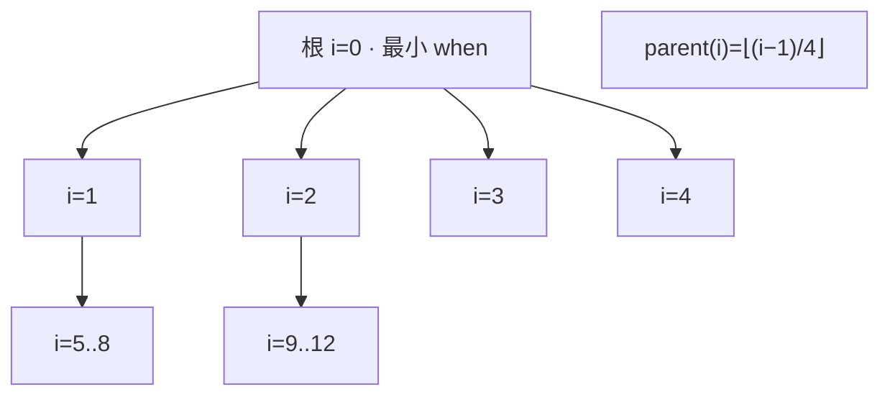

# HeapTimer

[](https://github.com/esrrhs/heap_timer)
[](https://github.com/esrrhs/heap_timer)
[](https://github.com/esrrhs/heap_timer/actions)
[](https://github.com/esrrhs/heap_timer/releases)

> **仅头文件的 C++ 四叉堆定时器：单调时钟截止时间，增删与到期扫描均为 O(log n)。**

[English](README.md) | [中文说明](README_CN.md)

---

## 简介

**HeapTimer** 是一个无第三方依赖的小型定时器，基于 **四叉最小堆**，灵感来自 [Golang 四叉堆定时器](https://github.com/golang/go/blob/release-branch.go1.3/src/pkg/runtime/time.goc)。

只需包含单个头文件 `heap_timer.h`，无需链接额外库。

## 特性

* **Header-only**：单文件、C++11、零依赖
* **四叉堆**：相对二叉堆层数更少，适合大量定时器
* **单调时钟**：截止时间使用 `std::chrono::steady_clock`
* **O(log n)**：`Add` / `AddAt` / `Del` / `Update`
* **仅可移动**：不可拷贝（节点不在实例间共享），**非线程安全**


## 算法演示

交互式可视化 **四叉最小堆** 定时器，**点开即可操作**：

**[▶ 在线算法演示](https://esrrhs.github.io/heap_timer/)**

（同源文件也可本地打开 [`docs/heap_timer_demo.html`](docs/heap_timer_demo.html)，单文件、无构建、无外部依赖。）

演示覆盖与 `heap_timer.h` 一致的操作：

- **插入 Insert（Add / AddAt）**：在 `heap_size_` 追加 `TimerNode { when, id, i }`，再沿父链 `(i−1)/4` **SiftUp**。
- **触发 Update**：当根节点 `when ≤ now` 时反复弹根（末尾换到下标 0，再 **SiftDown**），从 `timer_map_` 擦除并收集到期 id。
- **删除 Delete（Del）**：经 `timer_map_` 定位，标记 `i = -1`，末尾填洞后对该下标先 **SiftUp** 再 **SiftDown**（与 C++ 相同）。
- **堆调整 Sift**：`i` 的子节点为 `i×4+1 … i×4+4`；SiftDown 在至多四个孩子中选最小者下沉。

> 真实代码为仅头文件的 C++（`steady_clock`、`delay_ms`）。演示页用抽象时间单位做教学动画（高亮上浮/下沉路径与根弹出）。**非线程安全。**



## 前置依赖

* CMake (>= 3.12)
* C++11 编译器（GCC / Clang / Apple Clang / MinGW）

## 编译

```bash
./build.sh
```

或：

```bash
cmake -B build -DCMAKE_BUILD_TYPE=Release
cmake --build build -j
ctest --test-dir build --output-on-failure
```

Debug：

```bash
./build.sh Debug
```

产物：

* `heap_timer.h` — 库本体
* `build/bin/heap_timer_test` — 单元测试（默认）/ 可选 benchmark

运行长时间 benchmark：

```bash
./build/bin/heap_timer_test benchmark
```

## 用法

```cpp
#include "heap_timer.h"

HeapTimer t;

// 添加两个 1000ms 延时的定时器
auto t1 = t.Add(1000);
auto t2 = t.Add(1000);

// 删除第二个
t.Del(t2);

// 等待 1000ms
std::this_thread::sleep_for(std::chrono::milliseconds(1000));

// 扫描到期：返回已到期的 id（此处为 t1）
auto ret = t.Update();
```

绝对截止时间：

```cpp
auto id = t.AddAt(HeapTimer::Clock::now() + std::chrono::milliseconds(50));
```

版本宏（供宿主检查 / 打包）：

```cpp
HEAP_TIMER_VERSION_STRING  // 例如 "1.0.0"
```

## 发布

在 `master` 上修改 `heap_timer.h` 中的 `HEAP_TIMER_VERSION_STRING` 并推送后，Release workflow 会打 tag 并发布包含头文件的 GitHub Release。

## 许可证

[MIT License](LICENSE)
